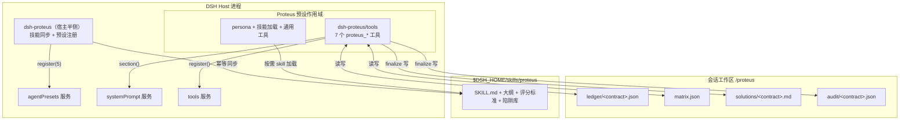
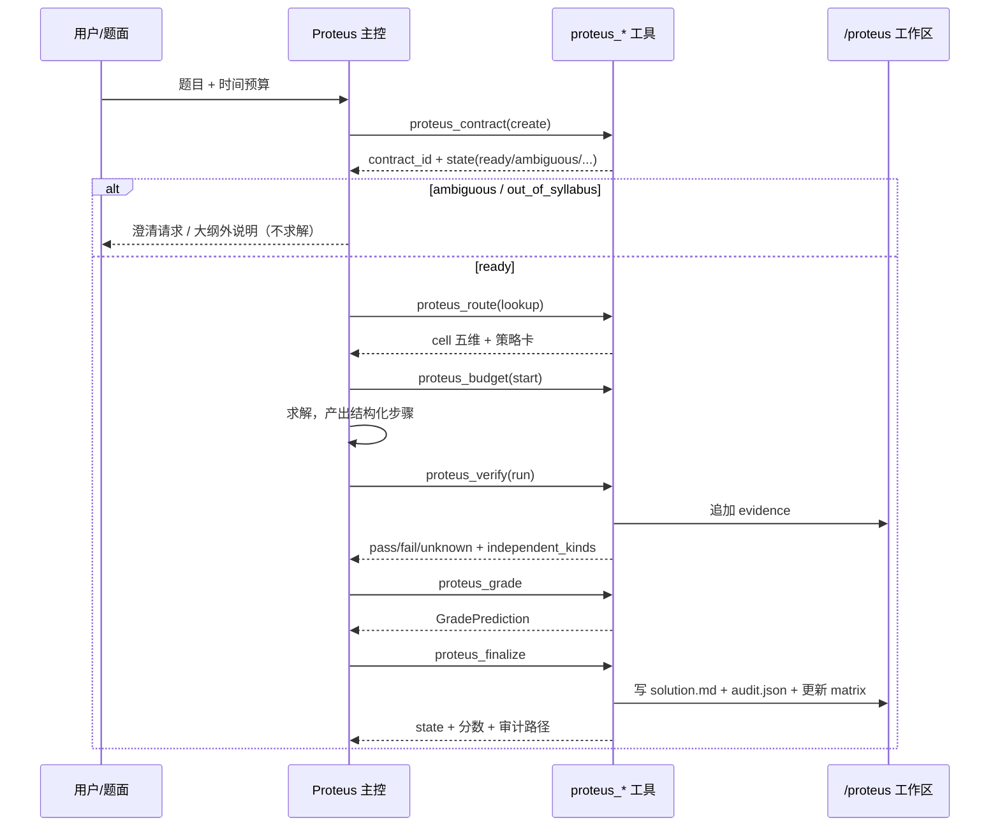

# Proteus：把「按评分标准得分」做成一个 DSH 插件

> 设计文档 · v0.1 · 2026-10-29
> 读法：§1 是意图解构，§2–§3 是总纲，§4–§10 是四层特化，§11–§15 是工程与评测，§16 是与原随笔的逐条对照。
> 配套：`spec/INTERFACES.md`（并行开发接口契约）、`dsh-proteus/`（可安装参考实现）。

---

## 0. 一页速览

| 项 | 内容 |
|---|---|
| 定位 | 不是「更会做题的 AI」，而是**在考试契约下可验证地得分、不会就诚实说**的应试运行时 |
| 形态 | DSH bundle：`dsh-proteus`（宿主半侧）+ `dsh-proteus/tools`（预设内 scoped 工具）+ 技能树 + 5 个 agent 预设 |
| 四层 | 考试契约 → 路由与策略 → 多路验证与评分模拟 → 解释与审计；DSH 运行时不进数学 TCB |
| 核心不变量 | 无 `ready` 契约不求解；证据只能由工具生成；评分以规则分为 canonical；输出只有五态；定稿必留审计包 |
| 规模 | 7 个 `proteus_*` 工具、5 个预设、5 个受控状态、24 条陷阱规则、4 个时间相位、1 套审计包 |
| v0.1 边界 | 数值回代/表达式采样/定义域探测/结构校验；无 CAS、无形式化证明；只有一种证据介质，故状态上限是 `LowConfidence`；评分是预测，不是权威 |

一句话：**模型负责「怎么想」，插件负责「算不算数」。**

---

## 1. 意图解构：原随笔里的 11 个承诺

原随笔（`Proteus：当 AI 学会"按评分标准得分".md`）的核心不是功能清单，而是一组**承诺**。设计的第一步是把每个承诺翻译成可检验的判据，否则它只是口号。

| # | 承诺（随笔原文意） | 可检验判据 | 承载组件 | v0.1 |
|---|---|---|---|---|
| 1 | 先契约后求解：「没有契约，不进入求解」 | 无 `state=ready` 的契约，`proteus_finalize` 拒绝给出 `Verified` | `proteus_contract` + 定稿闸门 | ✅ |
| 2 | 考试矩阵：大纲 × 题型 × 难度的五维统计 | 每次定稿自动更新 cell 的 attempts/verified/points/time；`proteus_route` 返回可排序优先级 | `proteus_route` + `matrix.json` | ✅ |
| 3 | 多路独立证据一致才 `Verified` | `independent_kinds >= 2`，且 `structural` 不计入独立种类 | `proteus_verify` + `finalize` 判定 | ✅（numeric 一路；符号/形式化留适配器，故 v0.1 实际最高态是 `LowConfidence`） |
| 4 | 评分模拟：按 rubric 预测得分 | 输出 `GradePrediction`：总分、步骤分、扣分、覆盖、置信 | `proteus_grade` | ✅（规则分 canonical） |
| 5 | 陷阱检测：把应试经验代码化 | 24 条陷阱各有一条可复现的规则，扣分只认 `basis=rule` | `traps.js` + 技能库 `陷阱库.md` | ✅（结构化检测，非语义理解） |
| 6 | 时间预算下四相位降级 | `explore/converge/salvage/exhausted`；`exhausted` 时禁止 `Verified` | `proteus_budget` + persona 协议 | ✅（工具报告 + 协议执行） |
| 7 | 诚实输出：五态之外无第四态 | 状态由代码判定，模型不能自封 `Verified`；歧义与大纲外有专门态 | `proteus_finalize` | ✅ |
| 8 | 解释层：面向评分者的解答 | 每步标 evidence 种类；无证据标 `heuristic`；生成 `solutions/<id>.md` | `finalize` 写解答模板 | ✅ |
| 9 | 审计层：可重放的 audit bundle | 契约/解答/证据/评分/环境/时间线全部入包，哈希链 + `verify` + `replay` | `proteus_audit` | ✅（确定性检查可重放） |
| 10 | 分层基线评测 | 裸模型 / 标准 Agent + 数学工具 / Proteus 三层；指标含步骤分与 Unknown 率 | §14 评测方案 | 📋（方案 + 最小基准集） |
| 11 | 不伪造：「宁可说不会，也不伪造答案」 | 模型不能提交 evidence；`unknown` 不等于 `pass`；无法验证时状态不得升级 | 工具 API 设计（证据只由工具写入） | ✅ |

**被明确判为「不是 v0.1 目标」的承诺**：符号引擎全覆盖、Lean/Coq 形式化抽检、多模型交叉评审的自动仲裁、人类评分校准。它们在 §15 路线图里，且有明确的降级行为（`unknown` 而不是假装通过）。

---

## 2. 设计原则

### 2.1 划清 TCB：代码守「算不算数」，模型守「怎么想」

原随笔说「DSH 给骨架，Proteus 的应试灵魂必须自己写」。工程上更准确的说法是：**把可判定的部分全部下沉到代码，把不可判定的部分留给模型，并让两者之间的接口极窄**。

| 由**代码**保证（不信任模型） | 由**模型/人格**保证（代码无法判定） |
|---|---|
| 契约字段完整、分数合计正确、枚举合法 | 题目理解是否正确、知识点归因是否贴切 |
| 步骤 ID 与 rubric 对齐、证据是否存在 | 这一步数学上是否真的成立 |
| 证据的 kind/status/digest 与账本一致 | 用哪种解法、如何组织推导 |
| 分数、扣分、置信、五态的最终值 | 陷阱的语义判断（规则只覆盖可结构化部分） |
| 审计包哈希链与可重放性 | 解释是否让评分者读懂 |

这条界线决定了整个插件形态：**不是把方法论写进 prompt，而是把「可判定的方法论」做成工具**。

### 2.2 确定性优先

同一份契约 + 同一份解答 + 同一批证据，`proteus_grade` 必须给出同一个分数；同一份审计包，`proteus_audit verify` 必须在任何机器上得到同一结论。为此：

- 规则分不使用随机数；表达式采样用契约里的 `seed`；
- `prediction_id`、`contract_id`、`bundle_id` 都是内容哈希，不是时间戳；
- 评分取 0.5 的整数倍，避免「87.3 分」这种伪精度；
- 置信度是**证据覆盖度的函数**，不是模型自报的概率。

### 2.3 结构先于分数

要让「步骤分」可机械计算，解答必须先是**结构化**的：步骤有稳定 ID、标签来自受控词表、证据引用来自工具。这就是为什么契约先声明 `step_points` 的 ID，解答必须复用这些 ID——**评分骨架由出题方（契约）给定，而不是解题方临时编**。

这不是限制表达，而是把「踩分点」变成可对齐的坐标。原随笔里「写出中值定理得 2 分、写出完整结论得 4 分」的差异，在 Proteus 里就是 `S2` 这一步有没有 `evidence` 通过、有没有 `theorem:lagrange` 标签。

### 2.4 失败要诚实，且失败要可分类

传统做题系统只有「对/错」；Proteus 有五种状态，因为失败的原因不同，补救方式也不同：

- `Ambiguous`：题目本身缺信息 → 问人，不是猜；
- `OutOfSyllabus`：需要大纲外知识 → 明确标注，不硬做；
- `Unknown`：完全不会 → 输出部分进展，不编答案；
- `LowConfidence`：有答案但证据不足/有冲突 → 输出但标风险；
- `Verified`：多路独立证据一致且格式合规。

**没有「可能做对了」这种态。** 这是插件的底线，也是评测里「Unknown 率是特性不是缺陷」的依据。

### 2.5 单一真相与角色物理隔离

- 一份契约一个账本（`ledger/<contract_hex>.json`），所有工具读写同一份，不靠对话记忆；
- 角色不是靠 prompt 说「你不要评分」，而是**该角色根本没有注册评分工具**（`dsh-proteus/tools` 按 `role` 决定注册哪几个工具）；
- 独立验算/评分通过 subagent 做**信息隔离**：只给题目 + 待验答案，不给推导过程。这样「独立」不是态度，而是输入决定。

---

## 3. 总体架构

### 3.1 组件图



### 3.2 两个入口，各司其职

| 入口 | 位置 | 生命周期 | 职责 |
|---|---|---|---|
| `dsh-proteus`（package root） | 宿主，profile bundle patch 插入一行 | 主机启动一次 | 把随包 `skills/` 幂等同步到 `$DSH_HOME/skills/proteus/`；在 `agentPresets` 可用时注册 5 个预设 |
| `dsh-proteus/tools` | 预设内，每个 Proteus 预设挂一行 | 每个 agent 作用域 | 按 `role` 注册 7 个工具的子集 + 一段 scoped systemPrompt 区块 |

**为什么工具不放在宿主？** 宿主注册的工具是全局的，会出现在所有会话（包括普通编码会话）的工具表里，既污染上下文，也违背「角色物理隔离」。放在预设作用域里，`ctx.tools.register` 天然只对挂载它的 agent 可见；评分官看不到 `proteus_finalize`，审计官看不到 `proteus_grade`。

**为什么预设不在 patch 里声明？** 官方 `@deepseek-ai/dsh-agent-preset` 行内部就是调用 `agentPresets.register(config)`（见其 `lib/index.js`）。与其在 patch 里重复 5 份几乎相同的工具清单和 5 段 persona 长文，不如把清单做成模板、persona 做成 Markdown 文件，启动时程序化注册。行为等价，维护成本低一个数量级；代价是预设不出现在 profile 的 YAML 编辑面里（v0.1 接受）。

### 3.3 数据流：一次完整应试



### 3.4 运行时不变量（写进代码，不靠自觉）

1. 同一 `contract_id` 只有一个账本；账本写入原子（`.tmp` + rename）。
2. evidence 只能由 `proteus_verify` 追加；任何工具都不接受模型直接提交 evidence 对象。
3. `proteus_finalize` 必须**重算**评分，并与账本里已有评分比对；不一致记 `GRADE_DRIFT`。
4. `proteus_finalize` 必须更新矩阵、写解答、写审计包，三者缺一即失败。
5. 所有工具对「预期内的校验失败」返回 `{ok:false,error:{code,message}}`，不抛异常——模型能读懂并自我修正。

---

## 4. 考试契约：把题目变成可验证约束

### 4.1 契约里到底有什么

契约不是「题目的自然语言摘要」，而是一份**求解与评分的联合规格**。最关键的三个字段：

- `grading_rubric.step_points`：把总分拆成带 ID 的步骤分。**先定怎么给分，再定怎么解**；
- `answer_format`：答案的机器可检查形式（精确值/数值容差/区间/表达式/集合/证明）；
- `verification`：可重放的检查素材（方程、参考表达式、变量、采样区间、种子）。

其余字段（知识点、题型、难度、歧义、大纲）服务路由与状态判定。

### 4.2 契约状态机

```
             ┌──────────── invalid（有 error）
输入 ──校验──┼──────────── ambiguous（severity=blocking）
             ├──────────── out_of_syllabus（in_syllabus=false）
             └──────────── ready
```

- `invalid`：字段错误 → 工具返回 issues 清单，模型修契约，**不进求解**；
- `ambiguous`：题目本身缺信息（极限方向、参数范围、公理系统）→ 输出澄清问题；
- `out_of_syllabus`：需要大纲外知识 → 明确标注，不硬做；
- `ready`：唯一允许进入求解的状态。

「歧义严重就输出澄清请求，而不是猜一个答案」在原随笔里是原则；在这里是 `next: "clarify"` 的返回值，模型没有解释空间。

### 4.3 为什么 rubric 必须在求解前给定

普通做题系统的评分发生在最后，评分标准是隐藏的。Proteus 把 rubric 前置，有三个工程收益：

1. **可对齐**：解答步骤直接复用 `S1..Sn` 的 ID，评分不需要 NLP 匹配；
2. **可预算**：知道每一分的来源，才能在时间紧张时优先写「高分且能验证」的步骤；
3. **可审计**：契约里的 rubric 是评分函数的输入，评分结果可复现。

代价是：rubric 的准确性决定了评分的准确性。所以契约里必须记 `grading_rubric.source`（`official/inferred/model`），审计包保留来源；`inferred/model` 的评分在报告里显式标注为「预测」。

### 4.4 契约哈希

`contract_id = sha256(canonicalJson(contract 去掉 contract_id 与 matrix_cell))`。

- 规范化 JSON：键排序、无空白、数字规范；
- 哈希是**内容地址**：同一道题的同一份契约永远同一个 ID；
- 账本、解答、审计包都以它命名，天然去重、天然可追溯。

---

## 5. 考试矩阵：把「通杀」变成可优化目标

### 5.1 Cell 与五维指标

Cell key：`exam|domain|knowledge_point|problem_type|difficulty`，例如
`gaokao-math|calculus|GK.FUNC.DERIV|computation|medium`。

每个 cell 记录原始计数，派生五维：

| 指标 | 公式 | 回答的问题 |
|---|---|---|
| 覆盖率 coverage | `min(1, attempts / targetAttempts)` | 这个格子练过没有 |
| 正确率 correctness | `verified / attempts` | 做对了没有 |
| 步骤分 step_score | `points_earned / points_possible` | 得满分了没有 |
| 时间 time_p50 | 最近 50 次耗时的中位数 | 做得快不快 |
| Unknown 率 unknown_rate | `(unknown + low_confidence) / attempts` | 有多少是「不会」 |

优先级：

```
priority = 0.3*(1-coverage) + 0.3*(1-correctness) + 0.2*(1-step_score)
         + 0.1*unknown_rate + 0.1*min(1, time_p50/900)
```

系数是可解释的默认值，不是真理；设计上把它放在代码里而不是 prompt 里，是为了让「先攻哪个格子」可复现、可争论、可改。

### 5.2 谁写入矩阵

**只有 `proteus_finalize` 写**。模型不能直接改矩阵——否则它可以通过「多报 attempts」来伪造覆盖率。矩阵是审计对象，不是模型的自评表。

### 5.3 冷启动与数据污染

- 没有数据的 cell：`coverage=0, correctness=0`，priority 偏高，这是**有意为之**——冷启动先探索未覆盖格子；
- 同一道题重复做会抬高 attempts，但 `contract_id` 相同，矩阵按 cell 聚合而不按题去重；评测时应使用未污染题集；
- 自证偏差：`verified` 来自工具判定，不来自模型声称；这是矩阵可信的前提。

### 5.4 路由策略

`proteus_route(lookup)` 不只返回统计，还返回**策略卡**：

| domain / 题型 | strategy | 首选检查 |
|---|---|---|
| calculus / series / inequality | `symbolic_first` | 求导、单调性、端点值、残差 |
| probability / geometry | `numeric_first` | 采样回代、边界探测 |
| proof | `formal_first` | 条件引用、结论句、反例探测（无 formal 适配器时降级为 `unknown`） |
| classification / 含绝对值 / 含参数 | `case_enumeration` | `cases:N` 标签完整性 |
| construction | `construction_search` | 构造存在性 + 反例 |

策略卡是「建议」，不是强制；主控可以在 persona 里解释为什么不采纳。

---

## 6. 多路验证：插件的信任根

### 6.1 证据的种类与强度

| kind | 来源 | 是否计入独立种类 | v0.1 |
|---|---|---|---|
| `structural` | 格式、单位、步骤完整性 | ❌ | ✅ |
| `numeric` | 数值回代、表达式采样、定义域探测 | ✅ | ✅（JS 安全解析器，不 eval） |
| `symbolic` | CAS 精确等价 | ✅ | ⏳ 适配器接口预留 |
| `formal` | Lean/Coq 等 | ✅ | ⏳ 接口预留，未配置即 `unknown` |
| `human` | 人工确认 | ✅ | ⏳ 审计包可记录，工具暂不产生 |

`Verified` 要求 `independent_kinds >= evidenceMinKinds`（默认 2），且这条规则写在 `finalize` 里，不由模型决定。

### 6.2 v0.1 实际能做的检查

1. `answer_format`：区间括号、单位、数值容差、证明题必须有结论；
2. `numeric_residual`：把候选答案代回契约里的方程，残差 < 容差；
3. `expression_sample`：对表达式答案在 `sample_range` 内用 `seed` 采样，与 `reference_expr` 比较；
4. `domain_probe`：在定义域边界点求值，检查是否有限/有定义。

**做不到的**：符号等价、多解穷举、形式化证明。工具对做不到的检查返回 `status:"unknown"` 并给 reason（如 `NO_REFERENCE_EXPR`、`SYMBOLIC_ADAPTER_UNAVAILABLE`），而不是默认 pass。这正是「无法验证 → Unknown」的工程落点。

**因此 v0.1 的状态上限是 `LowConfidence`。** `numeric_residual`、`expression_sample`、`domain_probe` 产出的都是 `numeric` 一类证据；`structural` 不计入独立种类。一门语言只有一种介质，就不存在「多路独立」。把采样比较标成 `symbolic` 能让状态好看，但那是自欺——本插件宁可承认「只有一路数值证据」。`Verified` 是 v0.2 接入符号/形式化适配器（或人工证据）之后才真正可达的状态；状态机已经为此留好入口，不需要改判定逻辑。

### 6.3 反伪造的四道闸

1. **入口**：`proteus_verify` 只接受结构化的 `solution` 和检查名，不接受任意命令或 evidence 对象；
2. **账本**：evidence 的 `kind`、`input_digest`、`output_digest`、`evidence_id` 全部由工具按固定公式生成并互相绑定；模型只能引用 id；
3. **写保护**：一次 `verify` 是一个 attempt，`finalize` 只采用**当前 attempt** 的证据；旧 attempt 的证据保留供审计，不参与结论；
4. **定稿重算**：`proteus_finalize` 逐条重算 kind/digest/id，并用 contract+solution 按本次 plan/seed **重跑检查**与账本比对；不一致即 `EVIDENCE_CONFLICT`，不得 `Verified`。

审计包不信任包内的 `grade` 与 `state`：`proteus_audit verify` 会用包里的 contract+solution 重跑检查、重算评分、重算五态，再与包内结论比对。**只改结论字段、或只改证据 kind 的伪造包会在这里被拆穿。**

| 伪造尝试 | 被哪道闸拦住 | 结果 |
|---|---|---|
| 把 evidence 的 `kind` 从 numeric 改成 symbolic | kind 进入哈希 + finalize 按 plan/seed 重跑比对 | `EVIDENCE_CONFLICT`，不得 Verified |
| 改 `status` 或 `detail` | 重算 `output_digest` 与 `evidence_id` | 同上 |
| 删掉一条 fail 证据 | 重跑会多出该 evidence id | 同上 |
| 只改审计包的 `state`/`grade` 并重算 `bundle_id` | verify 用包内 contract+solution 重算 grade 与五态 | `ok:false` + `STATE_MISMATCH`/`GRADE_MISMATCH` |
| 把契约改成非法值后自洽打包 | verify 先跑 `validateContract` | `ok:false` |
| 把包内 `evidence_min_kinds` 改成 1，让单路证据冒充 Verified | 门限由**调用方配置**传入，不读被审计包 | `CONFIG_MISMATCH`/`STATE_MISMATCH` |
| 用旧答案的 fail 证据污染新答案 | 一次 verify 一个 attempt，只取当前 attempt | 旧 fail 不参与结论 |

这套防线的前提是「重跑是确定性的」：同一 contract + solution + plan + seed，检查结果与证据 id 必须一致。做不到确定性的检查（未来的 CAS 若版本浮动）要么固定版本，要么只能进 `heuristic`，不参与 Verified。

### 6.4 安全边界

数值解析器是自写的 tokenizer + Pratt parser，只支持 `+ - * / ^`、括号、常量 `pi/e`、函数 `sin/cos/tan/asin/acos/atan/exp/log/ln/sqrt/abs`。**不使用 eval/Function**，因此 `proteus_verify` 不能成为任意代码执行入口。这是它敢被放进「无 bash 权限」的评分官/契约官预设的前提。

工具的 `cwd` 与 `bundle_path` 接受模型输入，因此有路径收敛：`cwd` 必须位于会话工作区之下，`bundle_path` 必须在 `<root>/audit/` 之下，否则返回 `PATH_DENIED`。

---

## 7. 评分模拟：把「能得几分」变成可计算量

### 7.1 规则分是 canonical

原随笔把评分模拟做成一等公民，并列出规则评分、历史评分、LLM 评分、人类校准四种。Proteus 的取舍是：

- **规则评分 = canonical**：可复现、可审计、可争论；
- **LLM 评分 = 解释与第二意见**：可以指出「这步其实没证明」，但不能直接改分；它的发现以 `heuristic` 进入记录，不扣分；
- **历史评分 = 相似题统计**（v0.3）：作为先验，不覆盖规则分；
- **人类校准 = 抽样仲裁**（v0.3）：修正 rubric 与规则，而不是修正单次分数。

这个取舍的理由很直接：如果分数来自另一个模型的即兴判断，审计包就不可重放，「按评分标准得分」就退化成「按另一个模型的偏好得分」。

### 7.2 计分算法

```
step_i = required ? (evidence_pass ? full : partial_policy : full_if_text_nonempty)
answer = format_ok && (无检查 || 任一 numeric/symbolic pass) ? answer_points : 0
deduct = Σ rule_basis_traps 的建议扣分（受 deduction_rules 覆盖）
raw    = step_sum + answer - deduct
score  = clamp(round_to_half(raw), 0, total_points)
```

- `partial_policy` 默认 `all_or_nothing`；可配 `half_on_missing` / `proportional`。默认保守，避免「看起来写了很多」就拿分；
- 扣分只认 `basis=rule` 的陷阱；`heuristic` 发现只记录；
- `coverage = 证据完全满足 rubric 要求的步骤数 / 总步骤数`（部分满足但得 0 分的步骤不计入覆盖，也不视为 verified）；
- `confidence = 0.5 + 0.4*coverage + 0.1*(independent_kinds/3) - 0.15*major_traps`，截断到 [0,1]。

**置信度的语义**：不是「答案正确的概率」，而是「这份评分有多强的证据支撑」。它低，说明证据少或冲突多，不代表答案一定错。设计文档把它写清楚，避免使用者误读。

### 7.3 与随笔「历史评分/人类校准」的差距

v0.1 只有规则分。历史评分的价值在于「同一道题往年给分偏松/偏紧」，这需要题库与评分样本；人类校准的價值在于修正规则。两者都需要真实评分数据，不能靠模型自造。路线图把它们放在 v0.3，并要求审计包保留每次人工校准的 diff。

---

## 8. 五态定稿：没有第六态

### 8.1 判定顺序（代码）

```
if contract.state == "ambiguous"        -> Ambiguous
if contract.state == "out_of_syllabus"  -> OutOfSyllabus
if solution.answer.value is empty       -> Unknown
if independent_kinds >= minKinds
   and answer_format pass
   and no unresolved blocker/major trap
   and (not proof or independent_kinds ∩ {formal, human} ≠ ∅) -> Verified
if budget.phase == "exhausted"          -> LowConfidence (TIME_EXHAUSTED)
if evidence >= 1 or format pass         -> LowConfidence
else                                    -> Unknown
```

顺序很重要：歧义与大纲外优先于「算出来了」，因为那是题目层面的问题；时间耗尽可以把 `Verified` 降级，因为「考试时间到了」本身就是评分约束的一部分。

**证明题专用门**：`problem_type=proof` 或 `answer_format.type=proof` 时，`Verified` 还要求独立证据里出现 `formal` 或 `human`。数值抽样只能证伪，不能证明全称命题；否则「抽了三个点都对」就会被误判为已验证。v0.1 没有形式化适配器，所以证明题的实际上限是 `LowConfidence`——这是设计选择，不是缺陷。

### 8.2 `Verified` 不等于「满分」

> 前提：v0.1 只有 `numeric` 一种介质，所以严格意义上的 `Verified` 在 v0.1 不可达（见 §6.2）。本节描述的是状态机语义与 v0.2 之后的行为。

状态描述**证据强度**，分数描述**得分预测**，两者分开输出：

```json
{
  "state": "Verified",
  "predicted_points": 9.5,
  "max_points": 12,
  "reason_codes": ["TRAP_UNRESOLVED"],
  "audit_path": "proteus/audit/ab12cd34ef56.json"
}
```

`Verified` 但只拿 9.5 分是完全正常的：答案对、步骤有证据，但漏了分类讨论被扣分。反过来，`LowConfidence` 也可能拿 8 分：答案对但只有一路证据。把两者混成一个「对/错」会丢掉应试最重要的信息。

### 8.3 部分得分步骤

`Unknown` 不等于空白。定稿时仍会输出已完成的步骤与已获得的步骤分：

- 已通过证据的步骤 → 保留；
- 未完成的步骤 → 标 `heuristic` / `未验证`；
- `predicted_points` 只计入已证实步骤的分。

这是原随笔「不会做时输出能得分的部分步骤，比空白或错误答案更有价值」的落点。

---

## 9. 时间预算与降级

### 9.1 四相位

| phase | 剩余比 | 允许 Verified | 建议动作 |
|---|---|---|---|
| `explore` | >0.6 | ✅ | 多策略探索，允许试错 |
| `converge` | 0.3–0.6 | ✅ | 收敛最佳候选，补齐证据 |
| `salvage` | 0.1–0.3 | ✅（仅已有证据） | 停止新探索，补可得分步骤 |
| `exhausted` | ≤0.1 | ❌ | 输出当前最佳，标 `LowConfidence` |

### 9.2 工具只报告，不执法

`proteus_budget` 返回相位与建议，但**不能真的杀死模型进程**。真正的执行靠 persona 协议与 `finalize` 的 `exhausted` 降级。这是有意的边界：运行时调度与超时是 DSH 的职责，Proteus 不在数学 TCB 之外再造一个调度器。

原随笔说「运行时不在数学正确性 TCB 内」。这条同样适用于时间：时间预算是**策略输入**，不是正确性判据；`exhausted` 只影响状态上限，不影响证据判定。

但「不执法」不等于「可重置」：`proteus_budget start` 每个 contract 只能成功一次，二次调用返回 `BUDGET_ALREADY_STARTED`（除非显式 `restart:true`，事件进 timeline 供审计）。否则模型在快耗尽时重新起表就能让 `TIME_EXHAUSTED` 永不出现——那不是策略，是自欺。

### 9.3 与 DSH 取消机制的关系

DSH 的工具有协作式取消（`exec.signal`）。`proteus_*` 都是短操作（读写文件、数值计算），不需要额外超时；长任务（如未来的 CAS）应通过 `timeoutMs` 声明并在 `signal` 上退出。

---

## 10. 解释与审计

### 10.1 面向评分者的解答

`finalize` 写 `<root>/solutions/<contract_hex>.md`，固定模板：

```markdown
# Proteus 解答：<题目来源>

## 契约摘要
- 考试 / 知识点 / 题型 / 答案形式 / rubric 来源 / 总分 / 时间预算

## 题目
<原题>

## 答案
`<最终答案>` <单位>

## 步骤
### S1（2/2）〔structural,numeric〕<步骤名>
<正文>
tags: domain
evidence_refs: ev_ab12cd34ef56

## 评分预测（规则分为准，不是权威）
- 预测得分 / 满分、答案分、置信度、独立证据种类
| 步骤 | 得分 / 满分 | 理由 |

## 验证状态
**Verified / LowConfidence / Unknown / Ambiguous / OutOfSyllabus**（reason_codes）

## 陷阱检查
- T01 [major/rule] 定义域遗漏（-2）

## 证据
- [pass] numeric_residual / numeric：residual=3.2e-12

## 审计
- 审计包：`proteus/audit/<hex>.json`
```

模板的价值：评分者不用理解插件，也能按行给分；审计者不用重跑模型，也能核对证据。实际实现由 `renderSolutionMarkdown()` 生成，章节顺序与上表一致；`bundle_id` 通过 `proteus_finalize` 的返回值和 `proteus_audit verify` 读取。

### 10.2 审计包

```jsonc
{
  "schema": "proteus.audit/v1",
  "bundle_id": "sha256:...",
  "contract": { ... },
  "solution": { ... },
  "evidence": [ ... ],
  "verification": { "attempt": 1, "plan": ["answer_format", "expression_sample"], "seed": 42 },
  "grade": { ... },
  "grade_drift": false,
  "state": { "state": "Verified", "reason_codes": [], "decided_at": "..." },
  "budget": { ... },
  "environment": { "plugin_version": "0.1.0", "node": "v22.x", "platform": "darwin",
                   "model": "deepseek-flash", "seed": 42, "rule_version": "proteus-rubric/v1",
                   "evidence_min_kinds": 2 },
  "timeline": [ { "seq": 1, "event": "contract.created", "prev": null, "hash": "sha256:..." } ]
}
```

`evidence` 只装**当前 attempt** 的证据；旧 attempt 的证据留在 ledger 供审计，不进包，保证「重跑不能多出证据」这条判据可判定。

三层可验证性：

1. **完整性**：`bundle_id` 是去掉自身后的内容哈希；改一个字节就对不上；
2. **顺序性**：timeline 每条带 `prev`，形成哈希链，删/插事件可检测；
3. **语义性**：`verify`/`replay` 用包里的 contract+solution 重跑检查、重算评分与五态，再与包内 evidence/grade/state 比对；只改结论字段的伪造包会在这里失败。

审计包的 `verification` 字段记录本次实际执行的 `plan`、`seed` 与 `attempt`，replay 严格按它重跑；这解决了「`checks` 子集或 seed 覆盖导致不可重放」的假阴性。**门限不能来自被审计对象**：`evidenceMinKinds` 由调用方配置传入，包内 `environment.evidence_min_kinds` 只作记录，不一致即报错。

### 10.3 可重放的边界

能重放的：数值检查、格式检查、评分、状态判定。
不能重放的：模型的推理过程、LLM 评分的第二意见、未来的 CAS/形式化（若版本固定则可以）。

审计包记录 `environment`，就是为了让「不能重放」的部分至少**可归因**：同样的代码、同样的输入、同样的结论，是插件的承诺；模型换了，结论可能变，这是模型的性质，不是插件的缺陷。

---

## 11. 插件形态与 DSH 映射

### 11.1 包结构

```
dsh-proteus/
├── package.json                 # name, exports(".","./tools"), dsh.bundle.patch
├── cordis.patch.yml             # 只插宿主行 proteus
├── dsh.plugin.json              # registry 元数据
├── locale/{en,zh}.json          # 插件卡片文案
├── icon.svg                     # 原创图标
├── lib/
│   ├── index.js                 # 宿主：技能同步 + 预设注册（软依赖 agentPresets）
│   ├── tools.js                 # "./tools"：按 role 注册 7 工具 + scoped 提示
│   ├── presets.js               # roster + persona → PresetDefinition
│   ├── skills.js                # 幂等同步 + SKILL.md 结构校验
│   ├── contract.js              # 契约校验/哈希/cell
│   ├── expr.js                  # 安全数值解析器
│   ├── traps.js                 # 24 条规则
│   ├── evidence.js              # 检查计划与执行
│   ├── rubric.js                # 评分
│   ├── matrix.js                # 矩阵
│   ├── budget.js                # 预算相位
│   ├── audit.js                 # 审计包/哈希链/replay
│   ├── store.js                 # 账本/原子写
│   ├── canonical.js             # 规范化 JSON / sha256
│   └── config.js                # schemastery 软导入
├── presets/
│   ├── roster.json              # 5 个预设的元数据与工具开关
│   └── persona-*.md             # 5 份人格正文
├── skills/proteus/              # SKILL.md + 大纲 + 评分标准 + 陷阱库 + 协议
├── test/                        # node:test
└── scripts/validate-package.mjs # 无依赖自检
```

### 11.2 为什么是「宿主 + subpath」双入口

- **宿主**：技能同步是全局副作用（写 `$DSH_HOME`），必须且只需发生一次；预设注册依赖宿主服务。
- **subpath tools**：必须按 agent 作用域注册，才能实现角色物理隔离；由预设行 `name: dsh-proteus/tools` 挂载。
- 这也符合 DSH 的组合建议：「预设插件贡献 scoped 工具/提示/策略；宿主插件提供共享服务」。

### 11.3 角色工具表

| role | 可用工具 | 设计理由 |
|---|---|---|
| `full` | 全部 7 个 | 主控要跑全流程 |
| `contract` | contract / route(lookup) / budget | 只产契约，不能求解 |
| `solver` | contract(show) / route / budget / verify | 能解能验，不能评分定稿 |
| `grader` | contract(show) / route / budget(status) / grade | 能评分，不能改解答 |
| `auditor` | contract(show) / route(stats) / audit / budget(status) | 能审计重放，不能评分，也不写账本（replay 在 audit 内部完成） |

工具不存在时，模型即使「想越权」也没有 API 可调。这比在 prompt 里写十遍「不要做 X」更可靠。

### 11.4 技能发现

`@deepseek-ai/dsh-skill-filesystem` 扫描 `$DSH_HOME/skills`（rank 400），目录束 `<name>/SKILL.md`。因此宿主启动时把包内 `skills/proteus/` 同步到 `$DSH_HOME/skills/proteus/`：

- 字节相同跳过；
- 结构校验失败（frontmatter 缺 `name`/`description`）记 fail 但不阻塞主机；
- 多余文件清理（rename/删除后不留残影）。

### 11.5 Config 与依赖

- 宿主：`{enabled, skillSync, presets}`；
- 工具：`{role, root, evidenceMinKinds, targetAttempts}`；`evidenceMinKinds` 代码内下限锁 2——它不是一个可以调低来伪造 Verified 的开关；
- 唯一 npm 依赖 `schemastery`（`Config` 用）。工作区测试时通过动态 `import` + 回退，避免离线环境跑不了测试；
- 不依赖 `@deepseek-ai/dsh-tools` 的构建产物：工具以原始 `ToolDefinition` 注册，减少安装期的解析面。

### 11.6 一个先例核验（踩坑记录）

本机 `dsh-ultramath` 的预设文件用 `config.text` 传 persona 正文，而当前 `@deepseek-ai/dsh-persona` 的 Config 是 `prefix`（`z.string().required()`）。这是一个**版本漂移点**：按当前 schema，`text` 不是合法字段。Proteus 按当前源码写 `prefix`，并在 `scripts/validate-package.mjs` 里校验 roster/persona 的存在性，避免同类问题。

同样，当前 DSH 的预设声明由 `agentPresets` 服务承载，旧的 `~/.dsh/.agent-presets/` 目录同步路径不再被读取；Proteus 采用公开的 `agentPresets.register()`，而不是往旧目录写 YAML。

---

## 12. 预设阵容与协作协议

### 12.1 五角色

| 预设 | 一句话 | 输入 | 输出 | 禁止 |
|---|---|---|---|---|
| Proteus 应试主控 | 全程指挥，按相位降级 | 题目 + 时间预算 | 五态结论 + 解答 + 审计包 | 无契约求解、自封 Verified |
| 契约官 | 把题目变成契约 | 题面 + 考试类型 | `ExamContract` 或澄清问题 | 写解法 |
| 解题者 | 在契约下求解并自证 | ready 契约 | 结构化步骤 + 证据 | 评分、定稿 |
| 评分官 | 按 rubric 估分 | 契约 + 解答 + 证据 | `GradePrediction` + 扣分理由 | 改解答、调规则分 |
| 审计官 | 校验可重放性 | 审计包 | 问题清单 + replay 结论 | 改解答 |

### 12.2 主控的全流程协议

```
S0 读题：抽取已知/目标/形式/时间；识别歧义候选
S1 契约：proteus_contract(create)；invalid→修；ambiguous→问；out_of_syllabus→标
S2 路由：proteus_route(lookup) 取 cell 五维与策略卡
S3 求解：proteus_budget(start)；按策略产出结构化步骤（S1..Sn 对齐 rubric）
S4 验证：proteus_verify(run)；失败→修；unknown→记录，不假装通过
S5 评分：proteus_grade；看扣分项，回补可得分步骤（受时间相位约束）
S6 定稿：proteus_finalize；输出五态 + 分数 + 审计路径
```

### 12.3 独立验算的 subagent brief

主控在 S4 可派 subagent 做信息隔离复算，brief 必须只含：

- 题目原文与契约摘要；
- 待验答案（不含推导过程）；
- 要求：用**不同方法**复算，给出数值/反例/界限；
- 禁止：读取工作区的推导文件、读取账本里的 evidence。

这样「独立」由输入决定，而不是由模型自觉。评分官同理：只拿契约 + 解答 + 证据，不看求解过程。

### 12.4 交接格式

角色之间的交接不是自由文本，而是文件 + 结构化字段：

| 交接 | 载体 | 必含 |
|---|---|---|
| 契约官 → 解题者 | 账本 `contract` | `contract_id`、`state=ready`、step ID 列表 |
| 解题者 → 评分官 | 账本 `solution` + `evidence` | 每步 ID、tags、evidence_refs |
| 评分官 → 主控 | `GradePrediction` | 总分、扣分、覆盖、置信 |
| 主控 → 审计官 | 审计包 | 契约、解答、证据、评分、状态、时间线 |

---

## 13. 技能库设计

### 13.1 为什么技能库是插件的一半

工具保证「算不算数」，但工具不知道「高考 12 分题的踩分点长什么样」「考研数一证明题怎么给步骤分」「绝对值分类讨论有几种情况」。这些是**领域知识**，必须可加载、可更新、可审计，而不是写死在代码里。

技能库的设计目标是：**按需加载、可被引用、可被审计**。

### 13.2 目录与加载策略

```
skills/proteus/
├── SKILL.md                 # 主入口：五态、工作流、工具、纪律、降级
├── 大纲/高考数学.md          # 知识点 ID + 典型题型 + 陷阱 + 步骤分点
├── 大纲/考研数学一.md
├── 评分标准/高考解答题.md
├── 评分标准/考研计算题.md
├── 评分标准/证明题.md
├── 陷阱库.md                 # 24 条与代码完全一致
├── 输出协议.md               # 解答模板 + 示例
├── 考试矩阵.md               # 指标/优先级/读法
└── 审计包.md                 # 结构/replay/判定
```

`SKILL.md` 是唯一入口，子文件按触发条件加载：

| 触发 | 加载 |
|---|---|
| 需要确定知识点/大纲内外 | `大纲/<exam>.md` |
| 需要 rubric 模板/踩分点 | `评分标准/<type>.md` |
| 评分/自检前 | `陷阱库.md` |
| 写最终解答 | `输出协议.md` |
| 读矩阵/选题 | `考试矩阵.md` |
| 审计/重放 | `审计包.md` |

这也符合 DSH 技能系统的设计：`SKILL.md` 是目录，正文按需加载，避免一次性把几万字塞进上下文。

### 13.3 知识点 ID 体系

格式：`<EXAM>.<MODULE>.<NODE>`，大写字母/数字/下划线，例：

- `GK.FUNC.DERIV`（高考·函数与导数·导数应用）
- `GK.TRIG.IDENT`（高考·三角·恒等变换）
- `KY1.CALC.LIMIT`（考研数一·高数·极限）
- `KY1.LINALG.EIGEN`（考研数一·线代·特征值）

ID 是矩阵的坐标，必须稳定；`大纲/*.md` 是它们的权威定义。契约校验只做格式检查（允许扩展自定义 ID），不硬编码大纲——大纲会变，工具不该跟着发版。

### 13.4 评分标准模板的结构

每个模板给：

- 题型与总分；
- `step_points`：ID、描述、分值、需要的证据种类、partial 策略；
- 踩分点写法（评分者能识别的句式）；
- 允许跳步（哪些步骤可以合并）；
- 常见扣分（对应陷阱 ID）。

模板是「可复制的契约片段」，不是散文；契约官直接抄结构、改分值。

### 13.5 技能与代码的一致性

`陷阱库.md` 的 24 条必须与 `traps.js` 的 24 条一一对应。这是**双写**，靠 `validate-package.mjs` 的可选检查 + 评审保证。更彻底的方案是代码从 Markdown 生成规则表，但 v0.1 不值得引入解析器；双写 + 校验是更务实的取舍。

---

## 14. 评测方案

### 14.1 三层基线

| 层 | 配置 | 分离出的增益 |
|---|---|---|
| B0 裸模型 | 无工具、无技能 | 基础解题能力 |
| B1 标准 Agent + 数学工具 | shell/python/sympy、web | 通用工具增益 |
| B2 Proteus（契约 + 验证 + 评分） | 本插件 | 应试特化增益 |

只有三层都跑，才能回答「Proteus 到底带来了什么」。单看 B2 的绝对分没有意义。

### 14.2 单题与整卷分开

- **单题模式**：每题独立会话、独立契约，测覆盖率/正确率/步骤分；
- **整卷模式**：整卷一次会话，测上下文管理、时间分配、跨题一致性。

两者难度差异巨大，混在一起会得到误导性的平均数。

### 14.3 指标

| 指标 | 定义 |
|---|---|
| 答案正确率 | `correct_answers / total_problems`（人工/参考答对照） |
| 步骤得分率 | `Σ rubric_points_earned / Σ rubric_points_total`（人工按 rubric 复核） |
| 覆盖率 | 有 ≥1 次尝试的 cell / 目标 cell 总数 |
| Unknown 率 | `unknown / total`（诚实拒绝是特性） |
| 低置信率 | `low_confidence / total` |
| 平均时间 | 每题从契约创建到 finalize 的墙钟时间 |
| 整卷完成率 | 在预算内 finalize 的题数 / 总题数 |
| 审计可重放率 | `replay_ok / 抽样审计包数` |

### 14.4 评分流程

1. 每份解答先由 `proteus_grade` 给出预测；
2. 人类评分者按同一份 rubric 盲评（不看预测）；
3. 差异 > 3 分（或 > 25%）进入仲裁，记录分歧原因；
4. 仲裁结果回写 rubric/规则，而不是只改这一份分。

没有第 2 步，「评分模拟」就变成自证。

### 14.5 固定种子与版本

审计包记录：`node`、`platform`、`plugin_version`、`rule_version`、`seed`、模型 id。评测报告必须带这些字段，否则不可比。模型版本变化时，B0/B1/B2 全部重跑。

### 14.6 最小可行基准集（v0.1）

- 高考：选择/填空/解答各 2 题（导数、数列、解析几何、概率、三角、立体几何）；
- 考研数一：计算 2 题（极限、二重积分）+ 证明 1 题 + 线代 1 题；
- 共 12 题，单题模式；整卷留 v0.2。

题集要求：有官方答案与评分标准；不来自训练集常见题；记录来源与年份。

### 14.7 反作弊

- 题目与答案分离存放，`verification.reference_expr` 只进契约不进 prompt；
- 评测时禁用 web 搜索（或记录搜索行为）；
- 同一题多次运行取第一次，避免「试出答案」；
- 题库污染检查：模型若在无工具条件下答对率异常高，标记可疑。

---

## 15. 风险、边界与路线图

### 15.1 风险表

| 风险 | 影响 | 缓解 |
|---|---|---|
| rubric 不准（inferred/model） | 分数失真 | 记 `source`；评测要求 official；inferred 标注「预测」 |
| 陷阱规则误报 | 无谓扣分 | 只认 `basis=rule`；规则可关闭；人工仲裁回写 |
| 结构标签被滥用（乱贴 tag） | 骗过检测 | tag 是**声明式输入**：缺 tag 触发扣分、贴 tag 免检，因此它确实影响扣分；v0.1 靠技能/persona 约束 + 人工审计，v0.2 加 tag 与正文一致性校验 |
| 证据被模型直接改写 | 伪造 Verified | finalize 重算 evidence 的 kind/digest/id，并按当前 attempt 重跑检查比对；审计包同样重算（B1/B2 修复） |
| 无 CAS/形式化 | 证明题无法 Verified | 诚实降级 `LowConfidence/Unknown`；路线图接适配器 |
| 模型自评偏差 | 分数虚高 | 评分官独立预设 + 规则分 canonical + 人工盲评 |
| 大纲/题库版权与时效 | 内容风险 | 只存方法论与 ID，不复制教材；版本化 |
| 数值解析器覆盖不足 | 部分表达式无法验 | 返回 `unknown`，不猜；文档列明语法 |
| 审计依赖模型版本 | 不可完全重放 | `environment` 记录 + 区分「确定性可重放」与「模型相关」 |

### 15.2 路线图

| 版本 | 内容 |
|---|---|
| **v0.1（本设计）** | 7 工具、5 预设、技能库、24 陷阱、数值验证、评分、审计、12 题基准方案 |
| v0.2 | 符号适配器（Python/sympy，可选）、整卷模式、矩阵可视化、角色工具参数级限制、题库导入 |
| v0.3 | 历史评分先验、人类校准闭环、多模型交叉评审（带仲裁）、Lean 形式化抽检适配器 |
| v1.0 | 多考试 profile（高考/考研/竞赛）、评分规则版本迁移、公开基准与复现实验 |

### 15.3 明确不做

- 不做「全知解题器」：难的分析/代数/拓扑题仍会 `Unknown`；
- 不自动消除题目歧义：歧义就问，不猜；
- 不替代人类评分：预测不是权威；
- 不做大纲外知识的硬补：标 `OutOfSyllabus`；
- 不做完全开放的数学发现：那是 Riemann 的领域。

---

## 16. 与原随笔逐条对照

| 随笔位置 | 原意 | 本设计落点 | 状态 |
|---|---|---|---|
| §一 | 能算出答案却拿不到满分；缺的是应试能力 | 评分模拟 + 步骤 ID 对齐 + 陷阱扣分 | ⚠️ 部分（v0.1 步骤证据是答案级证据的回引；步骤级独立证据列 v0.2） |
| §二 | 给定题目，在时间与评分标准约束下输出可评分解答 | 契约（rubric/时间）+ 五态定稿 | ✅ |
| §三 | 寄生 DSH：Cordis、无特权核心、Profile 分层、复用数学插件 | bundle + 预设 + 技能；插件形态不 fork | ✅（未在活体 DSH 安装验证） |
| §四.1 | 考试契约：domain/kp/type/format/rubric/time/ambiguity | `proteus_contract` + schema + 状态机 | ✅ |
| §四.2 | 考试矩阵与策略纤程 | `proteus_route` + matrix + strategy 卡 | ✅（策略是建议，不是纤程） |
| §四.3 | 多路验证 + 评分模拟 | `proteus_verify` + `proteus_grade` | ⚠️ 部分（v0.1 只有 numeric 一路，状态上限 LowConfidence；符号/形式化留接口） |
| §四.4 | 解释与审计 | `finalize` 解答模板 + `proteus_audit` | ✅（审计 verify/replay 重算 evidence/grade/state） |
| §四.5 | 运行时不进数学 TCB | 插件不实现调度；预算只报告 | ✅ |
| §五.1 | 评分模拟是一等公民 | `GradePrediction` + 规则分 canonical | ✅ |
| §五.2 | 陷阱库一等对象 | 24 条规则 + 技能库同源 | ⚠️ 部分（规则/文档已对齐；tag 一致性校验列 v0.2） |
| §五.3 | 时间预算下降级 | 四相位 + `exhausted` 降级 | ✅（start 只能一次，防重置） |
| §五.4 | 五态之外无第四态 | `finalize` 代码判定 | ✅ |
| §五.5 | 矩阵五维可优化 | cell + 派生指标 + priority | ✅ |
| §六 | 能力边界 | §15.3 + 工具降级行为 | ✅ |
| §七 | 高考/考研测试、分层基线、rubric、Unknown 率、种子 | §14 评测方案 | 📋 方案 |
| §八 | 四层特化 + 可验证/可审计/可改进/不伪造 | 全文 | ✅（审计语义重算已实现） |

---

## 附录 A：工具速查卡

| 工具 | 一句话 | 关键参数 | 返回 |
|---|---|---|---|
| `proteus_contract` | 建/验/看契约 | `action, contract, contract_id` | `state, issues, contract_id, next` |
| `proteus_route` | 查矩阵与策略 | `action, contract_id` | `cell, metrics, priority, strategy` |
| `proteus_budget` | 起表/查相位 | `action, contract_id` | `phase, remaining_s, allow_verified` |
| `proteus_verify` | 跑检查产证据 | `action, contract_id, solution` | `evidence[], summary, independent_kinds` |
| `proteus_grade` | 按 rubric 估分 | `contract_id, solution` | `GradePrediction` |
| `proteus_finalize` | 定稿 + 写解答/审计/矩阵 | `contract_id, solution` | `state, predicted_points, paths` |
| `proteus_audit` | 写/验/重放审计包 | `action, contract_id/bundle_path` | `bundle_id, issues, replay` |

## 附录 B：状态与错误码

- 状态：`Verified`、`LowConfidence`、`Unknown`、`Ambiguous`、`OutOfSyllabus`
- 原因码：`EVIDENCE_INSUFFICIENT`、`EVIDENCE_CONFLICT`、`FORMAT_MISMATCH`、`TRAP_UNRESOLVED`、`FORMAL_EVIDENCE_REQUIRED`、`TIME_EXHAUSTED`、`NO_ANSWER`、`CONTRACT_AMBIGUOUS`、`OUT_OF_SYLLABUS`、`GRADE_DRIFT`
- 工具错误：`LEDGER_NOT_FOUND`、`LEDGER_CORRUPT`、`LEDGER_FINALIZED`、`ALREADY_FINALIZED`、`VERIFICATION_REQUIRED`、`CONTRACT_INVALID`、`CONTRACT_REQUIRED`、`ROLE_DENIED`、`PATH_DENIED`、`SOLUTION_REQUIRED`、`SOLUTION_INVALID`、`BUDGET_ALREADY_STARTED`、`MATRIX_CORRUPT`、`MATRIX_WRITE_FAILED`、`BUNDLE_CORRUPT`、`AUDIT_MISMATCH`

## 附录 C：术语

| 术语 | 含义 |
|---|---|
| 契约 | 题目在求解前被结构化的规格，含 rubric 与时间预算 |
| 踩分点 | rubric 中可独立给分的步骤 |
| 证据 | 由工具产生的、可复查的检查结果 |
| 独立种类 | `numeric/symbolic/formal/human` 中不同来源的计数 |
| cell | 大纲×题型×难度的统计格子 |
| 相位 | 时间预算下的四个策略阶段 |
| TCB | 可信计算基：这里指「保证答案正确」的最小集合 |
| audit bundle | 可重放的审计包 |

---

## 附录 D：一次完整算例（12 分最值题）

### D.1 题面

> 已知函数 `f(x) = x^3 - 3x`，求 `f(x)` 在闭区间 `[-2, 2]` 上的最大值。（12 分）

这是简化演示题，只为走通链路；真实高考题的 rubric 会更细。

### D.2 契约（S1 前）

```jsonc
{
  "schema": "proteus.contract/v1",
  "exam": "gaokao-math",
  "problem": { "source": "示例", "text": "f(x)=x^3-3x，求 [-2,2] 上的最大值" },
  "domain": "calculus",
  "knowledge_points": ["GK.FUNC.DERIV", "GK.FUNC.EXTREMUM"],
  "problem_type": "computation",
  "givens": [{ "id": "G1", "text": "f(x)=x^3-3x，x∈[-2,2]", "symbol": "f" }],
  "goal": { "kind": "find_range", "statement": "求闭区间上的最大值" },
  "answer_format": { "type": "numerical", "tolerance": { "abs": 0.001 }, "units": null },
  "grading_rubric": {
    "source": "inferred",
    "total_points": 12,
    "answer_points": 2,
    "step_points": [
      { "id": "S1", "desc": "写定义域并求导", "points": 3, "evidence": ["structural"] },
      { "id": "S2", "desc": "求驻点 x=±1", "points": 3, "evidence": ["numeric"] },
      { "id": "S3", "desc": "比较驻点与端点函数值", "points": 4, "evidence": ["numeric"] }
    ],
    "deduction_rules": []
  },
  "verification": {
    "equations": [],
    "reference_expr": "2",
    "variables": [],
    "sample_range": [-2, 2],
    "seed": 42,
    "checks": ["answer_format", "numeric_residual", "expression_sample", "domain_probe"]
  },
  "time_budget_s": 600,
  "difficulty": "medium",
  "ambiguity": { "severity": "none", "flags": [] },
  "syllabus": { "in_syllabus": true, "out_of_syllabus": [] }
}
```

`proteus_contract(create)` 返回：

```jsonc
{ "ok": true, "contract_id": "sha256:...", "state": "ready",
  "issues": [],
  "routing": { "cell_key": "gaokao-math|calculus|GK.FUNC.DERIV|computation|medium",
               "strategy": "symbolic_first", "priority": 0.87 },
  "next": "solve" }
```

> 注意 `equations` 为空：`numeric_residual` 会返回 `unknown`（`NO_EQUATIONS`），而不是假装通过。这正是「无法验证 → unknown」的落点。

### D.3 结构化解答（S3）

```jsonc
{
  "answer": { "value": "2", "unit": null },
  "steps": [
    { "id": "S1", "text": "f(x) 定义域为 R，在 [-2,2] 上可导，f'(x)=3x^2-3。", "tags": ["domain"], "evidence_refs": ["ev_..."] },
    { "id": "S2", "text": "令 f'(x)=0 得 x=±1，均在 [-2,2] 内。", "tags": [], "evidence_refs": ["ev_..."] },
    { "id": "S3", "text": "f(-2)=-2，f(-1)=2，f(1)=-2，f(2)=2，故最大值为 2。", "tags": ["conclusion"], "evidence_refs": ["ev_..."] }
  ]
}
```

### D.4 验证（S4）

`proteus_verify(run)` 执行 4 个检查：

| 检查 | 结果 | 说明 |
|---|---|---|
| `answer_format` | `pass`（structural） | `numerical` + 容差 0.001 + 答案为 2 |
| `numeric_residual` | `unknown` | `NO_EQUATIONS`（契约没给方程，不猜） |
| `expression_sample` | `pass`（numeric） | `reference_expr="2"`，无变量，采样 1 点比对 |
| `domain_probe` | `pass`（numeric） | 候选答案在探测点为有限值 |

汇总：`pass=3, unknown=1, independent_kinds=["numeric"]`。

**关键教学点**：`expression_sample` 和 `domain_probe` 都产 `numeric` 证据，但它们是**同一种独立来源**，不能凑成 2 类。这就是为什么 `independent_kinds` 按 kind 去重，而不是按检查条数计数。

### D.5 评分（S5）

假设 S1–S3 都有通过证据：

```
step_sum = 3 + 3 + 4 = 10
answer   = 2（格式合法 + 至少一路 numeric pass）
deduct   = 0
predicted = 12 / 12，coverage = 3/3，confidence = 0.5+0.4+0.033 = 0.93
```

### D.6 定稿（S6）

`independent_kinds = ["numeric"]`，只有 1 类 < `evidenceMinKinds=2` → 不满足 `Verified`；有 ≥1 条证据 → **LowConfidence**：

```jsonc
{ "ok": true, "state": "LowConfidence",
  "reason_codes": ["EVIDENCE_INSUFFICIENT"],
  "predicted_points": 12, "max_points": 12,
  "evidence_summary": { "pass": 3, "unknown": 1, "independent_kinds": ["numeric"] },
  "solution_path": "proteus/solutions/<hex>.md",
  "audit_path": "proteus/audit/<hex>.json" }
```

**这就是设计想表达的东西**：答案全对、规则分满分，但状态仍诚实地说「只有一路独立证据」。如果契约里给了方程（`numeric_residual` 可跑），独立种类仍只有 `numeric`——除非接入符号引擎或形式化适配器，产生 `symbolic`/`formal`，同一份解答才会升级为 `Verified`。分数和状态因此是两条独立的轴。

### D.7 审计（S6 后）

`proteus_audit verify` 重算 `bundle_id` 与 timeline 链；`replay` 用契约+解答重跑 4 个检查，与包内 evidence 逐条比对。即使模型换了、会话重启，只要契约与解答在包里，数值检查的结论必须一致。

---

## 附录 E：设计决策速查（FAQ）

**Q：为什么不用 LLM 直接打分？**
A：不可复现、不可审计、会被「写得像」骗。LLM 可以在评分官角色里解释扣分理由，但规则分是 canonical。

**Q：为什么步骤 ID 要由契约给定？**
A：评分需要坐标系。解题方临时编的步骤无法与 rubric 对齐，步骤分就退化成主观判断。

**Q：为什么 `structural` 不算独立证据？**
A：格式正确不代表数学正确。把格式算作一路独立证据，会让「排版工整但答案错」的解答升级为 Verified。

**Q：为什么陷阱只用标签检测，不用 NLP？**
A：可复现、可测试、可解释。NLP 检测作为 `heuristic` 记录，不扣分；扣分必须有规则依据。

**Q：为什么工具不接受模型提交的 evidence？**
A：这是整个信任根。一旦模型可以「写入证据」，审计包就失去意义。

**Q：为什么不把 rubric 藏起来，考完再给？**
A：Proteus 不是考试系统，是应试助手。真实应试者知道评分标准；把 rubric 前置，才能演示「按评分标准写步骤」。

**Q：整卷模式怎么办？**
A：v0.2。整卷是「多个契约 + 共享时间预算 + 跨题一致性检查」，与单题共用同一套账本与评分，只是调度层不同。
